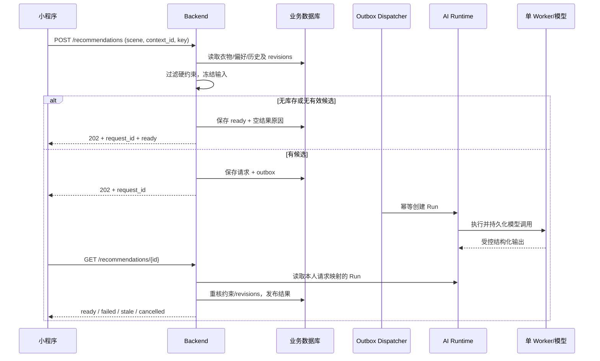

# 穿搭偏好与 AI 推荐｜功能设计

关联：[总体方案](../overview.md) · [衣柜管理](wardrobe.md) · [穿着记录](wear-history-and-stats.md) · [天气专项](../integrations/weather.md)

## 1. 功能与一次完整推荐

用户可预先设置长期偏好，穿搭页再选择本次场景（通勤、休闲、约会或不限）。点击“生成/换一套”后，系统仅使用本人可穿库存，结合已知属性、偏好、当天有效天气和最近已确认的穿着历史提出建议。天气、历史或偏好缺失时允许受限推荐；无有效候选时解释原因。

客户端按 `request_id` 查询已有任务；离开页面只暂停轮询。查看、换整套、替换单品只影响当前建议草稿，不写实际穿着；最终确认进入[穿着记录表单](wear-history-and-stats.md)。

## 2. 偏好、候选与模型输入

### 偏好与候选规则

`wardrobe_preferences` 按 owner 唯一保存喜欢/避免的风格、颜色、场合及可选舒适度，附 `version`。`GET/PUT /api/v1/preferences` 读取和完整保存，PUT 带 `expected_version`，与 `preferences_revision` 同事务更新。相同项同时标记喜欢和避免时返回字段错误，不替用户静默选择。本次 `scene` 仅作用于单次请求，不覆盖长期偏好。

Backend 在一致读中取得：本人的 `wearable` 衣物、偏好、近 30 个自然日已确认穿着摘要、三类修订号及关联天气上下文。候选判定规则：

| 输入 | 处理原则 |
|---|---|
| 归属与衣物状态 | 仅接受本人 `wearable` 衣物，始终硬校验 |
| 明确避免项 | 采用“满足/冲突/未知”三值判断；冲突或无法证明无冲突时不纳入合规候选，并解释限制 |
| 喜欢项、天气、近期重复 | 仅用于排序与理由；未知信息不能产生“已匹配”依据 |
| 属性或类别不全 | 无相应硬排除时仍可推荐，明确哪些判断缺少证据 |
| 仅一件衣物或只有一种类别 | 允许返回局部搭配，不要求固定上/下装，也不编造缺失衣物 |

风格只读取用户已填写且明确表达风格的标签等资料；版本化目录映射仅用于这些明确资料的标准化，不从类别、颜色或图片推断未记录的风格。先对所有有效库存执行硬过滤，再按可复现软排序选择输入范围；若超出模型容量，记录已覆盖的范围，不暗中只取分页首页或扩大调用次数。

### AI 输入输出契约

新增 `wardrobe.recommend.v1` 的结构化 DTO，不能复用现有 echo 文本字段来装库存 JSON。冻结输入包括候选衣物 ID/已知属性、偏好、历史摘要及时间范围、场景、有效天气事实或缺失原因、revisions、目录/策略/prompt/schema 版本。**不传入** openid、头像、图片文件/私有 URL、位置原始坐标及无关备注。

模型返回 `selected_ids[]、reason_codes[]、fact_refs[]、tradeoff_codes[]` 及调用证据引用；至少一件、不可重复、每件必须来自已筛选候选。Backend 使用受控事实引用组织最终理由和 `limitations[]`；模型自由文本不得直接作为天气或衣物事实。非法 ID、虚构证据或结构不匹配视为 `invalid_output`，不自动再付费调用“修复”。

## 3. 推荐接口、状态与结果消费

| 接口（`/api/v1` 前缀） | 关键语义 |
|---|---|
| `POST /recommendations` | `scene + weather_context_id + Idempotency-Key`；统一返回 `202、request_id、status`，无有效候选时可直接 ready |
| `GET /recommendations/{id}` | 仅本人可查询，返回执行状态、业务结果/原因；ready 读取时重核有效性 |
| `POST /recommendations/{id}/cancel` | 记录取消意图，与 ready 发布按请求行竞争；已完成不倒退 |
| `GET /recommendations/{id}/replacement-candidates` | 本人当前满足硬约束的可穿候选，支持分页；不强制与原单品同类别 |
| `POST /recommendations/{id}/validate-selection` | 输入当前草稿的 `selected_ids`；校验最新归属、状态、偏好与请求有效性，返回该组合及对应 `reasons[] / limitations[]`，不保存穿着、不调用模型 |

将**任务状态**与**正常业务结果**分开，以免把“无衣物”误报为模型失败：

| `status` | `outcome` / `error_code` | 客户端处理 |
|---|---|---|
| `dispatch_pending` / `generating` | 无 | 查询既有请求、显示进度 |
| `ready` | `recommendation` | 展示合法衣物、依据及缺失说明 |
| `ready` | `no_inventory` / `no_candidates` | 分别引导录入衣物/解释排除条件，不调用模型 |
| `failed` | `invalid_output` / `call_outcome_unknown` / 受控依赖错误 | 告知失败，可由用户发起**新请求** |
| `cancelled` | 取消原因 | 不发布迟到结果 |
| `stale` | `input_changed` / `weather_expired` | 提示依据已失效，重新请求 |

`status` 表示任务执行状态，`outcome` 表示正常业务结果，`error_code` 表示失败原因。对于已跨上海自然日的天气依据，旧建议不能被展示成“今天的天气”；含过期天气证据的当前推荐标 stale，历史证据按原始日期可追溯。天气本来缺失的建议不因此失效。

## 4. Backend 投递与结果发布

`recommendation_requests` 包括 id、owner、幂等键/hash、冻结输入与 revisions、关联天气上下文、ai_run_id、status、outcome/result/error 及时间。请求及 Outbox 命令在同一事务提交，避免“业务请求已保存但永远未投递”。

1. 首次请求按当前数据冻结输入。相同 `Idempotency-Key` 重试返回原请求，**不能因后续库存变化重新冻结**；不同 payload 同键为冲突。“换一套”使用新 key，可替换并取消旧的活动请求，但有限库存不保证结果一定不同。
2. Backend dispatcher 短事务认领 Outbox 命令，持有到期 lease；在事务外调用受信 AI API，以 `wardrobe:{request_id}` 作稳定 Run 幂等键。远端创建成功而本地未记录时，可按同 key 取回同一个 Run。
3. Backend 只查询自己保存映射的 `ai_run_id`，不接受客户端自报 Run 身份。投递超时到截止期可终结为 failed，迟到映射和结果不得复活请求。
4. 发布前先锁账号 revision 再锁推荐请求，复核最新 owner、wearable、排除项和冻结的库存/偏好/历史 revisions；任何 revision 变化按当前保守方案使旧结果 stale。页面再次读取或确认当前组合时也要重校验，不能只依赖最初发布。

## 5. AI Worker 与调用恢复

复用现有单 Worker、LangGraph Checkpoint 和受信 Run API。最小执行阶段为 `prepare → invoke → validate`；使用稳定 Operation 标识及持久化 payload hash、模型/prompt/schema 版本、发送状态、`response_ref` 和已知 usage。每个 Run 最多一次模型调用，无需为未发生的多次 attempts 强行建双表；如后续要求多次 attempts，再分离记录。

| 崩溃或中断位置 | 恢复动作 |
|---|---|
| `prepare` Checkpoint 未完成 | 可以重新准备；尚不允许发送付费调用 |
| 已准备，但未登记 `sending` | 登记后才发起请求；检查取消意图 |
| 已登记 `sending`、没有持久响应 | 结果可能已产生费用，置 `unknown`，本 Run 失败，**同次不自动重发** |
| 已持久化响应、Checkpoint 未更新 | 使用 `response_ref` 继续校验，不发第二次调用 |
| 完成与取消/finish 并发 | 终态条件写防覆盖；迟到输出不使取消的业务请求复活 |
| Worker 丢失持锁 DB 连接 | 旧执行者停止写入；不得用新连接继续作为旧持锁者提交 |

关闭 SDK、结构化包装及图节点的隐式重试；供应商 SSE 仅发生在 Worker 和模型之间，小程序仍轮询 Backend JSON。未知调用可记录后续供应商回执作诊断，但不得自动把失败 Run 改成功。当前范围不增加每日费用预算平台、多 Worker 或另一套队列。

## 6. 单品替换、取消和穿着确认

- 单品替换只修改当前组合草稿，保留其他已选衣物；不重复选中已有件，不重跑模型。客户端提交完整 `selected_ids`，Backend 在同一有效数据快照中重核请求、归属、可穿状态和明确避免项；空组合、重复项或不满足约束返回受控错误，请求依据变化沿用 `stale` 规则。
- 校验成功返回保持输入顺序的 `selected_ids` 及对应 `reasons[] / limitations[]`。Backend 复用受控事实与说明规则，只保留对当前衣物仍成立的依据；重新组织已知属性、偏好、近期记录和有效天气的说明，移除原组合特有且不再成立的理由。未知属性及缺失天气仍明确说明，不把用户手选组合描述成模型重新推荐的结果。
- 客户端以当前选择请求序号和会话代次匹配响应。校验期间保留选择草稿，暂不展示原组合理由，也不允许从该草稿确认推荐穿着；成功后一起更新组合与说明。失败时保留草稿，使用既有错误提示提供重试或重新选择；迟到响应不得覆盖更新的选择。
- 取消先持久写 Backend 意图，再通过 Outbox 通知 AI Runtime。ready 若已先提交则返回完成；取消若先提交则拒绝迟到结果发布。已发出的模型请求未必能撤回或免收费。
- 点击“确认实际穿着”只打开共用记录表单，用户核对日期和衣物后，由[穿着记录 API](wear-history-and-stats.md)保存。过期推荐不能直接绕过校验变成当前有效搭配；过去穿着可走手动补录路径。
- 生成失败或取消不得修改衣物数据，也不得产生穿着记录。

## 7. 关键验证

必须覆盖：单衣物/仅上装、未知属性、空偏好/历史、明确避免项、无有效候选、天气缺失、模型虚构 ID/理由、revision 变化、替换/换整套不写历史；替换后旧理由移除、新说明与组合一致、失败保留草稿、迟到校验响应不覆盖新选择且不调用模型；以及 Outbox 重复投递、模型 `sending` 后崩溃、响应持久化后重启、取消与 ready 竞争、迟到结果不复活。模型真实结构化输出与 usage 需单独接入验证，不能以 echo 测试通过代替。
