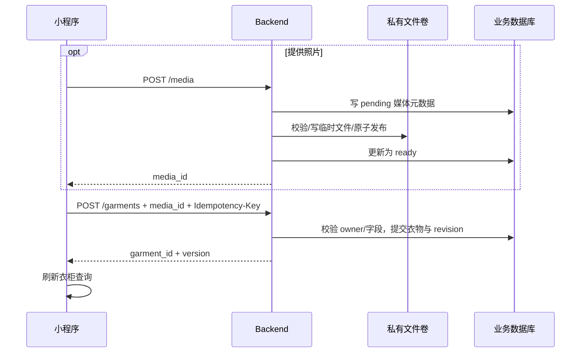

# 衣柜管理｜功能设计

关联：[总体方案](../overview.md) · [穿着记录](wear-history-and-stats.md) · [推荐](outfit-recommendation.md)

## 1. 功能与处理流程

用户可以添加、查看、筛选和编辑衣物，并在**可穿、暂不可穿、已归档**三个状态间切换。仅可穿衣物参与推荐；编辑或归档不会更改既有穿着历史。

| 功能 | 用户操作与系统结果 |
|---|---|
| 添加衣物 | 名称或已上传照片至少一项，其他属性可选；成功后创建本人 `wearable` 衣物 |
| 浏览/筛选 | 按状态、分类及已填写属性查询本人列表，分页读取并展示详情 |
| 编辑 | 更新当前属性或照片，保存后刷新详情/统计及推荐有效性 |
| 归档/恢复 | 只更新当前状态；历史不删除，恢复时由用户确定可穿或暂不可穿 |

**添加的完整链路：** 选择拍照/相册 → 可选上传图片并得到 `ready media_id` → 填写并提交 → Backend 验证账号、字段和媒体 → 单事务创建衣物、幂等收据与库存 revision → 客户端刷新列表。失败时保留用户草稿和该次保存的幂等键。

小程序页面包括衣柜列表、详情、添加/编辑。照片、名称、类别、主色为默认可见字段，其他属性可折叠但不得清空已输入值；拍照和相册分别调用平台适配。弹层取消不更新原值；固定操作、键盘、安全区和组件尺寸直接遵循现有设计交付，不在技术方案重复视觉规格。

## 2. 业务数据与规则

| 对象 | 核心内容及约束 |
|---|---|
| `garments` | UUID ID、owner、`name?`、`photo_media_id?`、`category? / color?`、`season[] / occasion[] / tags[]`、备注、status、version、时间戳 |
| `media_assets` | UUID ID、owner、用途 `garment/avatar`、私有存储 key、格式/大小、状态、时间戳 |
| 选项目录 | 稳定选项 ID/标签及版本，覆盖类别、颜色、季节、场合、风格；自定义标签为普通文本 |
| 幂等与版本 | `idempotency_receipts` 保留同次写入结果；`inventory_revision` 与衣物变更同事务递增 |

- **实体不变量**：创建和编辑后的名称非纯空白，或绑定同账号、用途正确且 `ready` 的图片。移除最后一张照片时如果名称为空必须拒绝；服务端校验媒体状态和归属，数据库兜底校验名称/引用至少一项。
- 缺少类别、颜色等属性表示未知；空列表表示未填写，不自动写入“其他”“四季”或推断出来的属性。多选值去空白、去重，枚举用目录稳定 ID。
- `PATCH` 的缺失字段表示不变，显式 `null`/空数组表示清空；通过 `expected_version` 防止并发覆盖。同键不同请求体返回 409；不在业务写入成功之前清空表单。
- 归档不删除衣物；穿着历史保存旧名称/类别快照，当前状态只影响新推荐。写事务统一先锁账号 revision，再锁相关资源，保证媒体绑定和历史保存的并发顺序。

## 3. 图片上传与访问

图片与衣物强耦合，保留在衣柜分方案内部，不另建“对象存储方案”。

1. **上传**：`POST /api/v1/media` 为认证 multipart，携带用途及幂等键；Backend 校验实际图片格式/尺寸/大小（建议先支持 JPEG、PNG、WebP，初始上限 10 MiB），去除 EXIF 位置等元数据并重编码。
2. **持久化**：先建 pending 元数据，事务外写私有持久目录临时文件并原子发布，然后短事务置 ready。以幂等键、用途及文件摘要识别重试；文件写成但状态未更新时先核对文件再恢复，不盲建副本。
3. **引用**：保存衣物/头像时锁定媒体行，检查 owner、用途、ready，再建立关联。仅已上传成功的 `media_id` 可提交；本地预览不是已上传文件。
4. **访问**：`GET /api/v1/media/{id}/content` 先验 owner 再流式返回。不生成公开 URL；小程序如需认证下载，先用带 Bearer 的 `downloadFile` 取当前账号临时路径展示。
5. **清理**：无资源引用的 ready 文件（如超过 24 小时）及长期 pending 文件由后台清理。清理与新绑定用同一行锁，先置 deleting 再删文件；已引用图片不可清理，失败可重试。

媒体目录必须位于公开静态路径之外，并挂载持久卷；禁止客户端传服务器路径或任意外部 URL，防止目录穿越。数据库和媒体卷需配套备份；无共享卷时不应直接部署多台读写独立本地目录的 Backend。

## 4. 接口及客户端消费

| 接口（统一 `/api/v1` 前缀） | 主要契约 |
|---|---|
| `GET /wardrobe/options` | 版本化选项目录；新旧选项 ID 的兼容须可追溯 |
| `GET /garments` | status/category/color/season/occasion/tag 过滤，cursor/page_size，返回 `next_cursor` |
| `POST /garments` | 字段和可选 `photo_media_id`，必填 `Idempotency-Key`；返回 ID、version |
| `GET /garments/{id}` | 当前衣物、version、已记录穿着次数 |
| `PATCH /garments/{id}` | 部分字段/status 与 `expected_version`，重校验最终实体 |
| `POST /media`、`GET /media/{id}/content` | 图片上传和经账号鉴权的访问，不能暴露存储 key |

列表按 `(created_at,id)` 稳定降序，默认每页 20、上限 100；筛选变化清旧游标并忽略旧响应。写成功刷新列表、详情、库存统计和依赖该库存的推荐；写失败不清草稿。所有对象访问先限定当前账号，跨账号 ID 按不存在处理。

## 5. 关键验证

必须覆盖：空名/无照片拒绝、上传失败与响应丢失后同键重试、编辑清空唯一有效字段、媒体文件与数据库部分成功、清理和绑定竞态、归档后旧历史不变、跨账号媒体/衣物拒绝、筛选分页乱序不污染页面。上述检查验证的是实际数据约束和用户结果，而非仅检查接口返回 200。
