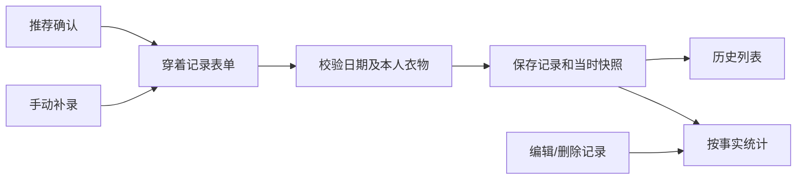

# 穿着记录与统计｜功能设计

关联：[总体方案](../overview.md) · [衣柜管理](wardrobe.md) · [穿搭推荐](outfit-recommendation.md)

## 1. 用户流程与业务边界

穿着事实来自两种入口：**在推荐页确认实际穿过**，或**在记录页手动选择衣物补录**。两者进入同一记录表单，用户确认日期和衣物后才提交。生成推荐、换整套或单品替换绝不直接形成历史。

用户可查看、修改、删除误记录；手动补录可选择本人当前已归档或暂不可穿的衣物，记录过去的真实穿着，但不改变这些衣物的推荐资格。同日可保存多套，不允许未来日期。

## 2. 数据、事务与快照

| 表 | 主要字段和约束 |
|---|---|
| `wear_records` | UUID ID、owner、`wear_date(date)`、version、创建/更新时间，可选推荐来源 ID |
| `wear_record_items` | record_id、garment_id、`name_snapshot`、`category_snapshot`；唯一 `(record_id,garment_id)` |
| `idempotency_receipts` | owner、操作、稳定请求 key、payload hash、响应摘要；旧请求不得复活已删除记录 |

- 保存日期统一按 `Asia/Shanghai` 判断“今天”，允许过去与当天，拒绝未来；只保存业务 date，不接收客户端时区，不用 UTC 创建时间反推穿着日。
- **创建**：核对幂等收据 → 锁 owner 的历史 revision → 校验本人衣物并读取当前名称/类别 → 同事务保存 record、去重 items、快照、revision、收据。任一步失败整体回滚。
- **修改**：校验 `expected_version`；保留的衣物继续用原快照，新加入衣物取现在的快照，移除项删除；仅改日期不改写既有名称/类别。
- **删除**：只删除目标记录和 items 并递增 `history_revision`，不删除衣物；记录删除后保留必要幂等 tombstone，防止旧 POST 再次重放创建。

客户端同次保存始终沿用原幂等键，成功后下一条记录才换键；同键不同内容返回 409。保存失败保留日期、选中衣物和草稿。记录与衣物修改并发时沿账号 revision → 资源 ID 的固定锁顺序执行，快照取本次事务确定的版本。

## 3. API 与页面消费

| 接口（统一 `/api/v1` 前缀） | 关键契约 |
|---|---|
| `GET /wear-records` | 时间范围、游标分页；返回历史记录及保存时的衣物快照、`next_cursor` |
| `POST /wear-records` | `wear_date`、非空 `garment_ids[]`、可选推荐来源、`Idempotency-Key`；同次提交最多一条记录 |
| `GET /wear-records/{id}` | 本人记录详情和 version，供编辑回填 |
| `PATCH /wear-records/{id}` | 修改日期及衣物，带 `expected_version`；并发冲突 409 |
| `DELETE /wear-records/{id}` | 删除本人记录，按幂等约定重复请求不误删别的记录 |
| `GET /statistics` | 本人衣柜数量、类别分布、穿搭数、单件次数、近 30 天趋势及统计日期范围 |

历史列表按 `(wear_date,id)` 稳定降序；多选弹层须在用户点击“完成”后才更新表单，取消保持原值。写成功使历史、衣物穿着次数、统计及推荐历史依据失效重取。

## 4. 统计口径

| 指标 | 计算规则 |
|---|---|
| 衣物总数 | 当前本人 `wearable + unavailable`，已归档单独展示 |
| 类别分布 | 对未归档衣物按当前 category 统计，NULL 单列为“未分类” |
| 穿搭次数 | 本人实际 `wear_records` 数，不计算推荐曝光或生成次数 |
| 单件穿着次数 | 关联该衣物的记录明细行数，同一记录同件只计一次；历史归档不清零 |
| 近 30 天趋势 | 北京时间的今天及此前 29 个自然日，按 `wear_date` 统计并补零，返回起止日/时区 |

`GET /statistics` 在同一数据库读快照内聚合衣柜与穿着事实，不维护异步累计计数字段。修改或删除记录后，下一次读取反映已提交结果。设备时区或天气城市变化不改写 `wear_date`，统计响应中的时区恒为 `Asia/Shanghai`。无历史显示“暂无已记录穿着”，不能断言用户从未穿过。

## 5. 关键验证

覆盖：同日多套、同件去重、重复提交及响应丢失、修改保留旧快照、删除与旧请求重放、归档保留历史计数、未来日期与北京时间午夜、并发版本冲突、跨账号访问，以及统计在修正/删除后无残留。推荐只能预填表单，必须由本模块的记录接口才写入穿着事实。
