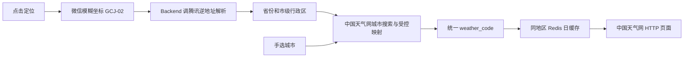

# 天气获取可行性与地区缓存

修订：R3｜日期：2026-10-22｜状态：中国天气网 HTTP 已选定，杭州天气与城市搜索样本已验证；模糊定位及服务端地区映射方案已确定，实际账号权限、逆地址解析接入及生产来源使用条件待落实。

面向技术评审者与后续开发者。需求依据为 PRD 的 FR-006、BR-004、AC-008/014/015；推荐消费见[推荐专项](recommendation.md)。本文定义拟建能力，不表示天气业务接口或 Redis 缓存已经实现。

## 来源与结论

**V1 天气来源确定为中国天气网城市 HTML，由 Backend HTTP 获取并解析。** 不接 MCP，不接 websearch，不在失败时调用另一家天气源。杭州样本证明页面包含可直接解析的结构化观测和当天预报，无需运行浏览器或网页脚本。

天气地址为 `https://www.weather.com.cn/weather1d/{weather_code}.shtml`，地区搜索地址为 `https://toy1.weather.com.cn/search?cityname={query}`；两者只由 Backend 调用。页面结构和搜索结果都按版本化 parser 校验。无法获取或校验失败时返回天气缺失，继续不依赖天气的推荐。

中国天气网独立实况地址曾返回 403，不属于本方案的数据接口。生产来源使用条件仍需落实，选择此来源不代表已取得其内容使用授权。

## 杭州样本与字段依据

主要样本为[杭州天气页面](https://www.weather.com.cn/weather1d/101210101.shtml)，站点地区码 `101210101`。2026-10-22 13:21（UTC+8）获取到约 76 KB HTML，单次 HTTP 请求约 0.25 秒。该数字只描述本次样本，不是延迟承诺或长期稳定性结论。

| 数据 | 样本事实与处理 |
|---|---|
| 地区 | `observe24h_data.od.od1` 为杭州；与服务端地区目录匹配后才接受 |
| 观测时间 | `od.od0=202610221300`，解析为 `2026-10-22T13:00:00+08:00` |
| 最新温度 | 首条 `od2` 的 `od21=13`、`od22=20.9`；校验小时与时间锚一致后得到 20.9°C |
| 字段含义 | 页面引用的[图表脚本](https://i.tq121.com.cn/j/weather2015/bluesky/c_1d.js)将 `od22` 放入温度序列，`od27` 放入相对湿度序列，避免仅凭数字猜字段 |
| 当天预报 | 日间多云、21°C；夜间多云、15°C；预报更新时间为 `2026-10-22T11:30:00+08:00` |
| 现象与温度边界 | 样本“多云”属于预报，不能标成 13:00 观测到的实时天气现象；21/15°C 也不能替代 20.9°C 观测值 |

解析仅提取指定变量的 JSON 字面量和指定 HTML 字段，不执行网页 JS、不使用 eval。缺字段、非有限温度、地区错误、首条观测小时不一致或未来异常时间均拒绝相应事实，不退回其他页面中的数字凑齐结果。完整日期来自来源，HTTP Date、Last-Modified 和 fetched_at 不替代气象观测时间。

观测数据优先保留最新一条；跨午夜的 24 小时数组不能全部套用 `od0` 的日期。当前消费只取与锚点匹配的首条，不为历史行擅自补日期。当天预报独立保留日期与发布时间；观测缺失但当天预报有效时仍可提供明确标注的预报上下文。

中国天气网的[版权声明](https://www.weather.com.cn/wzfw/banquan.shtml)明确限制未经书面许可使用其内容；本次技术可访问性验证不构成生产数据使用授权。

## 默认城市与选择顺序

默认天气城市为浙江杭州，`region_id/city_id/weather_code=101210101`，时区 `Asia/Shanghai`。杭州作为内置、已校验的初始目录项，首次使用默认城市不依赖定位、逆地址解析或在线城市搜索。

优先使用用户本次主动定位/手选成功确定的城市，其次使用账号已保存城市，均无有效值时使用默认杭州。定位失败/取消保留当前有效城市；从未选择过其他城市时继续使用杭州。异步请求按选择代次校验，旧定位响应不得覆盖新的选择。

默认城市只表示应用初始天气地区，不写成用户真实位置或伪装成主动选择；响应以 `selection_source=default/manual/location` 区分来源，默认态展示“默认杭州”。天气请求失败不改选另一城市，按天气缺失继续推荐。默认杭州、手选杭州和定位解析到杭州使用相同天气缓存 key，账号与城市选择来源不参与公共天气 key。

## 微信定位与个人主体适用性

城市天气不需要精确位置，客户端优先使用[wx.getFuzzyLocation](https://developers.weixin.qq.com/miniprogram/dev/api/location/wx.getFuzzyLocation.html)，最低基础库 2.25.0，请求 `type: gcj02`。只在用户点击定位入口时调用一次，不后台定位、不持续监听、不在进入页面或登录时自动申请位置。

个人主体不能仅凭“能调用 wx.login”推断已有定位权限。官方模糊定位文档未设置手机号组件那样的“非个人且已认证”限定，但明确要求与地理位置强相关的使用场景，并在公众平台「开发管理 → 接口设置」自助开通。因此当前个人主体方案可按天气场景核验/申请模糊定位权限，不能保证任意个人账号无需申请即可使用，也不能把文档允许申请写成具体 AppID 已获准。需在真实账号确认可申请入口和最终权限。

[wx.getLocation](https://developers.weixin.qq.com/miniprogram/dev/api/location/wx.getLocation.html)精确定位还要求符合开放类目并开通接口；工具类中的天气、信息查询列在官方开放场景中，但本衣柜应用不能借天气功能虚报类目。V1 不依赖精确定位，也不在模糊定位失败后自动升级申请精确位置。

实现时由平台适配封装原生 callback API 为 Promise，先检测接口可用性，不假设当前 Taro 版本已有对应包装。`app.config.ts` 输出的 app.json 声明 `requiredPrivateInfos: ["getFuzzyLocation"]` 和 `permission["scope.userFuzzyLocation"].desc`，用途为获取所在城市以查询天气。按[微信隐私指引](https://developers.weixin.qq.com/miniprogram/dev/framework/user-privacy/PrivacyAuthorize.html)声明位置信息及处理目的，完成隐私同意与 `scope.userFuzzyLocation` 授权后获取位置；登录成功不替代位置授权。坐标只用于本次城市解析，若交由腾讯位置服务处理，隐私声明如实覆盖该处理链路。

接口未开通、基础库不支持、用户拒绝/取消、设备关闭定位或定位失败分别保留实际状态，显示手选城市入口；拒绝后不循环弹窗。仅在用户再次主动操作时提供前往设置的途径。无其他有效城市时使用默认杭州；若该城市天气获取失败，天气缺失仍可推荐。

## 坐标、城市与天气地区码

Backend 使用腾讯位置服务[逆地址解析](https://lbs.qq.com/service/webService/webServiceGuide/address/Gcoder)，请求 `https://apis.map.qq.com/ws/geocoder/v1/`，`location` 按 `latitude,longitude` 顺序发送 GCJ-02，`get_poi=0`，不请求周边 POI或保留街道门牌。Key 仅在 Backend 配置，通过 `GeocodingPort` 隔离；没有可用 Key/服务权限时定位解析不可用，手选路径仍独立可用。本次只核对官方接口契约，未使用实际 Key 发起杭州逆地址解析。

逆地址结果取省份、市名和 `ad_info.city_code`；该字段由国家码和市级行政区划码组成，文档定义为 9 位。不能将区县 adcode 直接当作天气码，也不能用截断区县码来猜城市。对于普通中国大陆城市，在确认国家码和格式后可将市级 city_code 关联到地区映射；直辖市、省直辖县级市及行政区划更名均走受控别名/显式映射，不能盲目套普通地级市规则。

天气缓存按市级天气地区归一。微信模糊坐标不足以保证街道/区县精度，自动定位不据此选择最近区县气象站。接口返回实际解析出的城市供展示，用户可用现有手选入口改正；手选城市优先，迟到的定位结果不得覆盖新的手选值。

中国天气网搜索使用 URL 编码 query，响应为包裹 JSON 数组的文本；只移除预期包装后做 JSON 解码，不执行 JSONP。每项 `ref` 由 `~` 分隔，按固定版本提取天气码、省份、名称与上级名称。只接受格式符合 `101` 开头的 9 位数字、能匹配行政城市的候选，排除景点和街道条目；数字格式只是初筛，不能独立证明候选地区正确。

后端维护版本化 `weather_regions` 目录：`region_id/weather_code/province/city/aliases/geocoder_city_code/mapping_version`；V1 可用已校验 weather_code 作为稳定 region_id，`geocoder_city_code` 可为空。首次城市搜索经 schema、类型和省市匹配校验后幂等登记目录，不依赖一次性抓取全国完整 JS 城市表。自动定位先查已验证行政区关联，未命中时按市名搜索并核对省市完整上下文；唯一匹配才登记关联。重名/多结果/无结果时交回手选，不用第一条或“最近”候选冒充正确城市。

杭州搜索已通过普通 HTTP 验证：原始 6 条结果含景点与外省同名街道，过滤并核对省市后唯一有效城市为 `浙江 / 杭州 / 101210101`。因此“只搜杭州并取首条”不是有效的通用映射规则。`geocoder_city_code` 对杭州的期望关联为 `156330100`，该关联是待真实逆地址调用核验的配置依据，不记作已测成功。

手选入口调用 `GET /api/v1/cities?q=&cursor=`，返回 `region_id/city_id`、省市展示名、固定天气时区与稳定天气码关联；用户必须选择候选，而不是把输入文本直接保存为有效城市。上游不提供分页时，对当前有限候选过滤/分页，结果用尽返回空 next_cursor，不声称上游支持游标或全国完整检索。选中的 city_id 必须在后端目录中重新校验，客户端不能提交任意 weather_code 拼接 URL。

手选杭州与定位解析到杭州最终使用同一 region_id，因此不同用户、不同坐标和两种入口共享同一份杭州日天气；仅城市目录和天气快照共享，账号设置、精确/模糊坐标、位置响应不得进入公共天气缓存或日志。

## 天气上下文接口

Backend 保留 `WeatherPort.resolve_location/today_weather`，地区解析委托 `GeocodingPort` 和天气地区目录。`POST /api/v1/weather/context` 可显式提交坐标或 city_id，二者互斥；均未传时读取已保存城市，无保存值则使用默认杭州。坐标请求同时声明 `coordinate_system=gcj02` 与 `location_kind=fuzzy`，校验范围与来源类型，不把未知坐标系按 GCJ-02 处理。坐标在本次解析后丢弃，不落位置历史。

返回有账号归属的 context_id；公共天气 payload 可跨用户共享，个人城市选择和推荐状态不得进入公共缓存。推荐校验 context_id 归属与有效期，不接受客户端自报天气。payload 包含 `region_id/region`、`weather_date`、`weather_timezone`、`source/source_url`、`parser_version`、`fetched_at`、`valid_until`，以及可缺失的 observation 和 forecast。observation 含 `observed_at/temperature_c`；forecast 含 `forecast_date/issued_at/day_summary/night_summary/high_c/low_c`。不同部分分别保存更新时间，对外 `updated_at` 对应实际展示的数据部分。

HTTP client 的天气、搜索和逆地址解析分别使用固定域名与路径，限制单响应 1 MiB、连接超时 2 秒、单次外部请求总时限 8 秒；客户端不直接访问这些服务或持有 Key。跳转目标需校验，不拼接 shell、不跟随任意用户 URL。地区未解析、上游失败、结构变化或地区/日期校验失败均形成明确缺失上下文，保留手选入口，继续无天气推荐。

## UTC+8 与 Redis 共享日缓存

天气查询日、缓存日界及返回时间统一采用 `Asia/Shanghai` 的当前 UTC+8 规则，不受用户穿着记录时区设置影响，也不依赖宿主机器的默认时区。来源自带 UTC 时间先按真实时区解释，再转换为 `+08:00`；未知时区不能通过直接附加 `+08:00` 伪造。绝对时间仍可内部存 UTC，API 与页面展示明确的 `+08:00`。

**同一规范地区在同一个 UTC+8 自然日共享一份天气快照，默认当天复用；历史缓存保留 7 天后清理。** 不同用户复用同一个地区 key。日缓存按自然日实现，23:50 建立的当天缓存也在 00:00 停止作为当天有效数据，而非跨日再复用 24 小时。

缓存键：`weather:v1:{source}:{parser_version}:{region_id}:{YYYYMMDD}`。例如杭州为 `weather:v1:weathercom:obs-v1:101210101:20261022`。city_id/来源地区映射稳定后使用规范 region_id；切换来源或解析版本不能命中旧内容。key 不含 user_id、坐标、昵称或个人偏好。

| 时间/状态 | 规则 |
|---|---|
| 业务有效期 | `valid_until` 为该查询日结束后的 UTC+8 00:00；只读取当天 key，并复核 payload 日期和有效期 |
| 7 天清理 | 数据 key 用 `EXPIREAT` 设为缓存日加 7 天的 UTC+8 00:00，以 Redis TTL 自动清理，保留约 7 个自然日；到期后不可读取，物理回收遵循 Redis 过期机制 |
| 历史 key | 仅用于受限排障/复核，不能作为新一天的当前天气回源；保留不等于有效 |
| 当日观测 | 复用首次获取的观测快照，保留 observed_at；数小时后不能改写成“刚刚更新”或“实时温度” |
| 当日预报 | 保留当天预报及 issued_at，推荐可消费预报字段；不因跨用户共享而复制私人上下文 |
| 错误缓存 | 外部失败/no_weather 使用独立短期错误 key，建议 60 秒，且不跨日；避免一次暂时失败导致全天无法重试 |

一天缓存降低抓取次数，同时意味着当天气象变化不会自动反映。展示应为“当日缓存天气/预报，数据时间 HH:mm”；旧观测不保证请求时刻的实时温度。若以后要求动态实况，应显式改短业务有效期，而非偷偷加入刷新规则。

读取顺序为：规范地区及 UTC+8 日期 → 读 Redis 当天 key → 校验命中 → 返回；miss 时申请同 key 的 `SET NX EX` 刷新锁（建议 15 秒），持锁者二次检查缓存后抓取、校验并发布。其他请求短暂等待后重读，超过请求时限则返回天气暂不可用，不各自抓取。锁租期与业务缓存有效期独立配置。

锁值使用随机 token，发布及释放时以 Lua 校验 token 和日期；锁已过期的旧执行者不能写入覆盖新结果。抓取跨 UTC+8 零点时不得将昨日数据写入今日 key，当前请求按新日期重新查询或返回缺失。对有效结果一次性写 payload 和到期时间，不写永久 key。

天气缓存复用现有 `backend/app/core/redis_client.py` 的可选缓存依赖策略：Redis 故障不绕过认证所需 Redis 检查；已通过认证的天气操作可在进程内合并请求并受限直接 HTTP 回源，失败则天气缺失。地区逆解析失败不使用 IP 推测或模型猜测位置。

天气上下文可以冻结进推荐输入，但保留相同 valid_until；昨天创建的 context_id 不能因缓存仍保留而用于今天的新推荐。已有推荐中的历史天气证据按原始日期展示，不改写成今日天气。

## 已验证范围与后续检查

已验证杭州 HTML 的 HTTP 获取、JSON 字面量解析、地区/观测小时匹配、温度字段映射及观测与预报区分。北京、上海、深圳页面亦能获取和解析相同观测结构，仅作为结构交叉核对，不证明全部城市覆盖。

当前方案的时间边界是：UTC+8 23:59 仍命中当天 key，次日 00:00 切换新 key，旧 key 留存但不得复用；2026-10-22 的历史 key 在 2026-10-29 00:00 到期。同地区不同用户共享 payload，不同地区/来源/版本隔离。

后续实现需用隔离 Redis 检查跨用户命中、同地区并发只抓一次、锁超时旧写入被拒、UTC+8 跨日、7 天过期、负缓存后恢复及 Redis 故障回源。解析 fixtures 覆盖空观测、错城市、未来日期、昨日页面、仅有预报、预报发布时间与观测时间不同。当前未实现或运行这些 Redis 集成检查，也没有实际 AppID 的定位开通/真机授权、腾讯逆地址调用、生产来源使用条件或长期可用性结论。

地区解析后续检查包含：首次无定位/无保存值使用默认杭州、已保存其他城市不被默认值覆盖、默认/定位/手选杭州得到相同缓存 key、杭州景点/外省同名街道过滤、同名城市省份冲突、直辖市/省直辖县级市、模糊位置跨城市边界、手选与定位响应竞态、坐标系错误、Key 未配置及用户拒绝隐私/位置授权。微信后台开通、开发者工具模拟和真机定位分别取证，不能互相替代。
