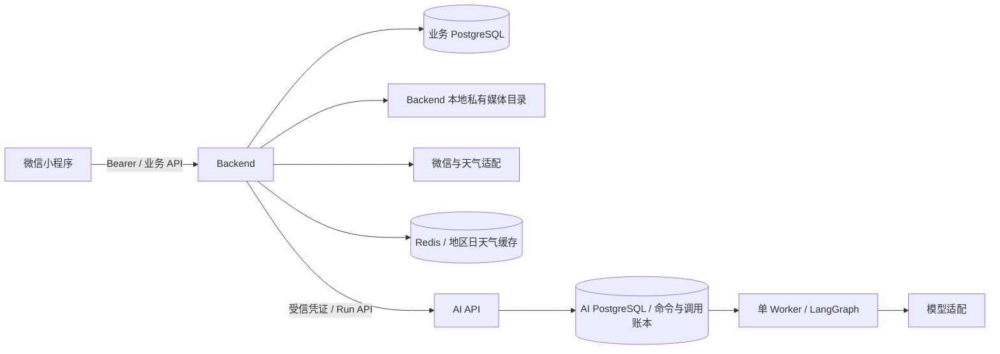

# 智能衣柜 V1 技术方案

修订：R6｜日期：2026-10-22｜状态：模型与中国天气网 HTTP 来源、调用不明不自动重发、Backend 本地存储及单 Worker 范围已确定；库存变化校验边界见推荐专项，真实接入与最终产品验收待完成。

面向产品、设计评审者和后续开发者。本文描述拟建能力；代码现状仅见“实现依据”，不代表业务已经实现或验证。

## 方案摘要

以 [PRD V1.2](../../product/01-prd-draft.md) 的 FR-001～FR-006、BR-001～BR-008 和 AC-001～AC-023 为范围，交付微信小程序个人衣柜完整流程。复用 Taro 客户端、同步 FastAPI 业务后端、PostgreSQL 和现有 AI Runtime；Web 保留现有用途，不新增业务页面。

核心决定如下。

| 决定 | 理由与代价 |
|---|---|
| Backend 独占身份、衣物、媒体归属、偏好、穿着事实和统计 | 沿用现有鉴权与事务边界；所有资源查询先限定账号，客户端不能自报 owner。AI 不直接访问业务库 |
| 微信身份关联现有 User，复用 Bearer 与撤销机制 | 保留既有 Web 用户名密码契约，不把微信用户伪装成可密码登录账号；需要小规模用户表迁移和微信身份表 |
| 历史明细保存衣物快照，统计直接聚合事实 | 满足后续编辑/归档不改写历史；不另维护容易残留的累计计数，初期承担聚合查询成本 |
| 图片由 Backend 认证上传并写入本地持久目录 | V1 不接第三方 OSS；复用 Backend 资源授权，部署需要持久卷，避免容器重建丢失图片 |
| 推荐使用现有持久队列和单 Worker，增加调用状态与响应记录 | 可承受小程序离页与网络中断；比同步调用增加恢复机制，但不引入第二套队列或多 Agent |
| 模型沿用 PricePilot 的 `gpt-6.1-sol` 与服务端模型网关；天气采用中国天气网 HTTP，微信模糊定位经腾讯逆地址解析映射城市，不接 MCP | 模型连接方式有现有项目依据，天气来源和日期可追溯；本项目仍需独立凭证配置与实际接口验证 |
| 推荐候选与硬约束由代码裁定，模型负责候选组合与受限理由 | 不依赖 prompt 保障归属、可穿状态和排除项；属性未知保持未知，输出不包含无依据的天气/材质推断 |

[数据与业务专项](features/inventory-and-history.md) 定义保存、媒体、历史及统计；[推荐与执行专项](features/recommendation.md) 定义候选、模型协议、跨库投递、取消及恢复；[天气专项](features/weather.md) 定义杭州可行性证据、来源条件及 UTC+8 的 Redis 共享日缓存与 7 天清理。专项按能力维护，下游 Change 引用相关章节，不重写总架构。

### 主要风险与评审点

- **设计验收**：最终页面视觉与运行交互待验收；设计来源及预览状态见[设计交付](../../../miniprogram/design/wardrobe-ui-ux.md#检查与接受)。
- **模型恢复策略已确定**：同一次调用结果不明时不自动重复请求；保存 unknown 并结束本次生成。用户主动重试才创建新请求，已保存的响应可恢复读取。
- **执行与费用范围已确定**：V1 使用现有单 Worker，不做容量规划、多 Worker 扩展或费用预算/每日额度管理。保留调用超时、模型协议上限与请求幂等；费用预算不作为启用或规划的待确认条件。
- **存储方案已确定**：由 Backend 本地文件存储实现，目录在公开静态目录之外；私有图片仍逐请求校验 owner。持久卷、备份和文件/数据库一致性需在部署及相关检查中落实，不依赖第三方 OSS。
- **微信基础登录可行**：个人主体可采用 `wx.login → code2Session` 获取当前小程序 openid 并建立本项目会话，无需手机号或自动获取头像昵称。实际 AppID/AppSecret、服务端出口 IP 配置、业务 HTTPS 域名与上线条件仍需按实际账号落实，不能把基础登录可用等同于已完成发布审核。
- **库存变化校验有明确用途**：生成等待或页面离开期间，所选衣物可能被归档/设为不可穿，或用户改了避免项；返回及消费结果前检查可避免继续展示不可用推荐。当前 revision 整单失效策略较保守，具体边界见[推荐专项](features/recommendation.md#库存变化与结果有效性)，不引入后台持续监控。
- **天气来源已选定，接入条件待落实**：杭州页面 HTTP 获取和结构化解析已验证，天气与城市搜索来源均确定为中国天气网 HTTP；微信模糊定位及腾讯逆地址解析的实际账号权限/Key 和来源使用条件仍待落实；天气默认杭州 `101210101`，有效主动选择或已保存城市优先；按 UTC+8 自然日同地区共享缓存，历史保留 7 天清理。日缓存保留原数据时间，不承诺实时刷新。

## 输入与实现依据

需求源为 PRD V1.2。设计源为 [需求级交付记录](../../../miniprogram/design/wardrobe-ui-ux.md)、[业务 UI](../../../miniprogram/design/wardrobe-ui-spec.md)、[可编辑稿](../../../miniprogram/design/wardrobe.pen)。设计中的主要页面与交互如下：

- 主页面 `P9tls/ddC69/HI38Z`、详情 `WV7wn`、表单 `Ro2vL/FfxoI`、记录 `tz4GK`、统计 `ywaWl`、个人 `QL83M`、微信登录 `asaVm`，以及推荐完整内容源 `ZHXw9`。
- 场景 `Q3U4y`、替换 `AvD3c`、城市 `NLCY6`、穿着多选 `mKPcR`、分类 `phKmP`、颜色 `zXmjy`、标签 `kopCO`、资料 `LgGyr`、确认 `m0rZ7` 与空态 `SKORD`。
- `AvD3c` 为即时单品替换，`mKPcR` 是完成后才回填的多选；前者画面中的“下装”是示例，不能转成必须同类别或必须有下装的业务规则。普通失败/loading 引用交付记录与既有 Notice/StatePanel；不要求每个状态另画一页。

| 已核对代码 | 现状、触发条件与最小处置 |
|---|---|
| [User](../../../backend/app/models/user.py)、[AuthService](../../../backend/app/services/auth_service.py) | 当前 username/password_hash 必填，仅支持密码；微信首次登录不能直接使用，按下一节新增身份关联 |
| [鉴权依赖](../../../backend/app/api/dependencies.py)、[认证路由](../../../backend/app/api/v1/auth.py) | 已有用户 ID/JWT/Redis 撤销，复用；缓存 User 只含旧字段，资料读取单独查询，不能据此缓存对象读取新资料 |
| [gateway](../../../miniprogram/src/shared/api/gateway.ts)、[wechat adapter](../../../miniprogram/src/shared/platform/wechat.ts) | 已有请求信封、code、单图选择与上传原语；尚无 code 交换、媒体资源协议、定位。选图来源需增加 camera/album 参数 |
| [app.config](../../../miniprogram/src/app.config.ts)、[UI 出口](../../../miniprogram/src/shared/ui/index.tsx) | 原生导航和示例 Tab，PageShell 无固定动作/自定义顶栏能力；需业务宿主，不能只换标题或假定已有 Bottom Sheet |
| [AI schemas](../../../ai-service/src/ai_service/api/schemas.py)、[bootstrap](../../../ai-service/src/ai_service/bootstrap.py) | 仅 echo DTO 与注册；新增版本化 wardrobe workflow 和判别式 DTO，不能将库存 JSON 塞进 echo.text |
| [AI API](../../../ai-service/src/ai_service/api/app.py) | 服务 token 对应配置 scope，非每用户租户；Backend 必须保有用户映射并逐请求授权，不开放 Runtime 到小程序 |
| [worker](../../../ai-service/src/ai_service/worker.py)、[store](../../../ai-service/src/ai_service/infrastructure/store.py) | 单 Worker、同连接锁与 Saver、短事务及终态保护可复用；echo 无外部副作用，真实模型必须补专项恢复机制 |

## 模块与共享边界

Backend 沿用 route → service → repository → model；service 拥有业务事务，不在事务内等待微信、天气、存储或 AI HTTP。AI application/core 使用协议，infrastructure 拥有 SDK；两个服务不导入彼此源码、不跨库 JOIN。拟新增业务服务为身份、媒体、衣物、偏好/个人设置、穿着/统计、天气和推荐编排；不增加业务微服务。

业务表使用现有 `users.id` 为 owner，新增资源 ID 使用 UUID。时间点存 UTC `timestamptz`，穿着日存 `date` 和保存时区。业务返回沿用 `{code,message,data}`；422 字段错误沿用安全 `loc/type/msg`，404 隐藏跨账号对象是否存在，409 表示版本/幂等冲突，429 表示限流，外部依赖不可用返回明确业务错误。内部错误不向客户端暴露微信或供应商原始响应。

Schema 仍由提供方 Pydantic/路由生成，根 OpenAPI 快照再生成小程序类型。下文列的是拟议语义，不手工更改生成契约，也不把未实现接口记入当前有效契约。

### 微信身份与会话

个人主体小程序的基础微信登录可用。[wx.login](https://developers.weixin.qq.com/miniprogram/dev/api/open-api/login/wx.login.html) 获取临时 code，Backend 按[code2Session](https://developers.weixin.qq.com/miniprogram/dev/server/API/user-login/api_code2session.html)以本小程序 AppID/AppSecret 交换 openid 并建立业务会话；这与网站微信扫码登录的申请条件不同。基础登录不等于获取用户头像、昵称或手机号的授权，不强制弹出资料授权流程。

头像昵称按[官方填写能力](https://developers.weixin.qq.com/miniprogram/dev/framework/open-ability/userProfile.html)自愿选择与填写。[手机号快速验证组件](https://developers.weixin.qq.com/miniprogram/dev/framework/open-ability/getPhoneNumber.html)当前要求非个人主体且完成认证，本项目不依赖该能力。个人主体适合当前不要求手机号的账号方案；类目资格、备案/审核、服务器与隐私配置属于实际发布条件，本次未登录公众平台核验具体账号。

新增 `wechat_identities(user_id, app_id, open_id)`，唯一 `(app_id, open_id)`；一个微信身份固定映射一个 User。不依赖 unionid 合并账号，不提供跨账号自动绑定。`users.password_hash` 改可空，密码登录显式拒绝无密码账号；`username` 继续作为现有 API 技术字段，由服务端生成不可猜碰撞的唯一值，不当昵称展示。已有密码用户不回填微信身份，既有密码登录消费者保持契约；这一兼容路径支持仓库现有 Web 模板，并非新增衣柜登录选项。

`POST /api/v1/auth/wechat {code}` 由 Backend 调用微信交换服务；只取服务端验证后的 `(app_id, open_id)`，不存储/返回 session_key，不接受客户端 openid。外部交换在事务外；首次建 User 与身份同事务，唯一冲突后读取已提交身份以处理并发。超时/无效 code 不创建用户，不对同一 code 自动重试；用户重试重新调用 `Taro.login`。服务签发既有 JWT，客户端持久化成功后才视为登录。按来源进行限流，不记录 code/secret。

新增 `GET/PATCH /api/v1/profile` 返回/保存可选昵称、头像媒体 ID、城市选择与 IANA 时区；默认昵称在展示层使用“衣柜用户”，不写成用户真实资料。头像使用微信填写组件得到的临时路径并走同一私有上传，不保存任意远程 URL。默认时区 `Asia/Shanghai`，提交时验证时区名。

客户端 query key 包含 `user_id` 与会话代次；退出/401/切换身份时取消请求、清 Query、草稿和推荐状态，迟到响应按代次丢弃。复用现有匹配 token 的 401 清理。退出先调用既有撤销接口：成功后清本地；失败也清本地并如实提示服务端撤销未确认，不宣称已撤销。持久化 token 清除失败必须可见并阻止旧 token 下次自动恢复，可用独立的本地退出标记优先于恢复逻辑，重新登录存储成功后清标记。不得通过清缓存伪造远端撤销成功。

## 小程序结构与状态

主 Tab 注册衣柜、穿搭、记录，使用微信 custom-tab-bar 和 `switchTab` 保留平台页面语义；详情、表单、统计、偏好、个人为普通页面。组件演示不再占业务 Tab，保留开发入口与原组件能力，不扩展本次业务范围。

业务宿主组合主题根、自定义顶栏、唯一滚动区、固定操作与自定义 Tab。不能复用 PageShell 的原生 Tab inset 再叠一份安全区；为其增加明确的业务布局模式或在业务壳独立处理，原模板调用保留既有模式。`navigationStyle: custom` 后读取真实窗口、状态栏、胶囊与安全区，不能把画布 44/24px 当常量；系统胶囊和 Home Indicator 不重绘。底部高度由实际动作区、Tab、安全区相加，滚动区仅扣一次。

业务表单状态保存在页面，更多属性收起只改显示状态；跨页选择草稿按用户/编辑实例隔离。Bottom Sheet 使用本端 View/事件与遮罩实现，关闭背景滚动；取消不改原值，确认类操作使用独立临时选择。替换候选即时选择只改当前搭配。所有弹层需原生返回键/关闭操作和 48px 命中区。共享组件暂无这类出口，先放业务组合，不导入 Web Radix。

键盘事件由业务壳订阅/成对释放，键盘显示隐藏固定表单动作并滚动焦点字段，关闭恢复。使用 Taro Input 现有 adjustPosition 配合，避免两套键盘偏移叠加。主题使用 [移动 Token](../../../miniprogram/design/tokens.md) 和真实 `tokens.scss`，视觉几何按业务 UI 局部覆盖；不整体缩放适配窄屏。

远端数据由 Query 管理，写失败不清草稿，写成功按业务依赖精确失效：衣物更新刷新衣柜/详情/统计并使推荐校验过期；穿着变更刷新记录/单件计数/趋势与推荐历史依据；偏好更新使推荐重校验。mutation 不自动重试；用户主动重试沿用同次幂等键。页面隐藏暂停轮询，恢复立即读取现有任务，不重新生成。

衣柜、历史、两个衣物选择器采用服务端筛选和游标分页，初始 page size 20、上限 100；按 `(created_at,id)` 或 `(wear_date,id)` 稳定降序。条件变化清旧游标，取消或忽略旧查询响应；选中的 ID 不因翻页丢失。无搜索框的稿不强加全局搜索 UI；城市输入由中国天气网搜索适配生成候选，用户选择稳定 city_id 才算有效；微信模糊坐标由 Backend 调腾讯逆地址解析，再按省市匹配天气地区目录，具体权限与映射契约见[天气专项](features/weather.md#微信定位与个人主体适用性)。筛选未知值单列；所有下拉/色块值来自版本化选项目录 API，设计示例不能充当完整枚举。

## 交付约束与验证

数据库以 Alembic 新增业务表及 nullable password_hash 迁移，AI 表以追加 SQL 版本迁移，Saver 初始化独立运行。新增唯一约束上线前检查存量冲突；旧用户保持原 ID。回滚应用前必须先确认旧密码校验不会读取 NULL；含微信用户后不得直接降级至不兼容版本或将 NULL 改回 NOT NULL。新增业务表有数据后不自动 drop 回滚，以前向修复为主。workflow `wardrobe.recommend.v1` 与输入/prompt/schema 版本冻结，未完 Run 保留对应执行器直到完成或显式失败，不覆盖历史迁移。

| 需求/高影响约束 | 最小后续检查 | 失败证据与处理 |
|---|---|---|
| BR-008、AC-010/022 账号隔离 | 两账号遍历衣物、媒体、历史、推荐、偏好读写与迟到响应 | 可读写他人对象或切号残留即修鉴权/缓存，不改 PRD |
| FR-001/002、AC-001/002/007/021/023 | 照片成功/失败、空名、多选收起、归档及历史快照断言 | 空衣物入库、输入丢失或历史改写即修业务事务/表单 |
| FR-004/005、AC-003～005/011/016～018 | 真实隔离 PostgreSQL 并发同键保存、跨时区日期、修改删除与聚合 | 重复行/残留计数/未来日期写入即修约束与聚合 |
| FR-003/006、AC-006/008/009/012～015/019 | 固定 adapter fixture 检查未知、硬排除、单品库存、天气降级、过期/取消 | 越权 ID、编造天气、放宽排除、迟到覆盖即修候选/发布门 |
| 持久执行不重复外部调用 | 在账本准备、发送后未保存、响应保存后、结果发布前后注入中断并重启 | 相同 Operation 再发或终态覆盖即修恢复协议，暂停 live |
| AC-020 与业务宿主 | 静态核对注册/布局；后续明确授权下用开发者工具/真机核对键盘、胶囊、滚动及两主题 | 遮挡/双 inset 返回同一实现；源稿矛盾返回设计来源 |

专项补充具体失败时序。执行时按受影响端 README 运行必要测试；共享契约需导出与直接消费者检查。当前只定义这些验证，未启动服务、浏览器、小程序、迁移或外部调用。

实施规划以 PRD、设计交付、本文及相关专项为依据。真实微信、天气、本地媒体与模型集成的验收依赖实际配置、有效来源、域名、隐私配置及隔离环境；最终运行与产品验收待完成。
