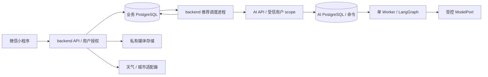

# 智能衣柜 V1 技术方案

修订：TD-1｜日期：2026-10-19｜状态：待人工评审，尚未实施。

面向产品评审者、规划者及小程序、后端、AI 服务开发者。实现 [PRD V1.2](../../product/01-prd-draft.md) 的个人衣柜完整链路，交付平台仅为现有 `miniprogram/`。本文及专项定义拟建能力；代码现状单独列出，接口表不是已经生效的 OpenAPI。

## 1. 方案概览与关键决定

复用 Taro + React 小程序、同步 FastAPI 后端和现有单 Worker AI Runtime。backend 是账号、衣物、媒体授权、偏好、穿着事实和业务推荐的唯一拥有者；AI 服务只接收受信后端冻结的上下文，生成无业务写入权限的建议。小程序不直连 AI、数据库或供应商。

| 决定 | 理由与代价 | 重审条件 |
|---|---|---|
| 复用 `users.id`，新增微信身份关联 | 统一现有 JWT/撤销链路，避免第二套业务账号；保留仍被 Web 模板使用的密码认证，微信账号无可用密码 | 需求增加跨 AppID 身份合并时另行设计，不能仅凭 UnionID 自动合并 |
| 业务事实落 backend PostgreSQL，统计实时聚合 | 修正与删除在下一次读取即生效，无计数补偿链；列表与聚合需有索引 | 实测聚合不能满足目标负载后，再评估可重建读模型 |
| 历史保存名称、类别快照，日期保存为业务日 | 后续编辑/归档不改过去含义；修改时区不重写已确认日期 | 产品要求按精确发生时刻重新归日时需回到 PRD |
| 推荐异步执行，backend 保存快照及派发任务 | 适配现有队列/Checkpoint，避免 15 秒客户端请求承担模型时延；增加一个可恢复的后端调度进程 | 仅有实测吞吐需求时考虑多 Worker，当前不引入消息总线 |
| 推荐先确定性过滤，再模型选择，发布前再次校验 | 模型不能放宽归属、状态和避免条件；库存变化时返回需重试，不能悄悄补全 | 排除语义变化先修订 PRD；不以模型表现替换确定性校验 |
| 模型、天气和私有文件存储经小接口注入 | 用户已确认暂无指定供应商；默认不调用真实外部服务。需补适配器和真实联调证据 | 选定服务无法满足输入、隐私、预算或恢复契约时重审对应适配边界 |

**评审重点**：历史日期及快照语义、避免条件遇到未知值的处理、异步推荐取消/恢复和发布校验。上述技术决定尚未取得人工内容批准，可与下游计划同次评审，无需逐专项签字。

**主要风险**：微信平台配置尚未核实；供应商、模型能力、天气城市覆盖、容量和成本均无实测；现有 Runtime 缺少真实调用所需的 Ledger/预算/取消。最新登录、个人及添加衣物设计局部仍待人工验收，不能记为已接受。当前可以形成技术评审稿，但不能宣称业务联调或产品验收通过。

方案按能力组织：[衣柜、媒体、穿着与统计](features/wardrobe-and-history.md) 拥有业务事务；[天气与推荐执行](features/recommendations.md) 拥有外部调用、跨库投递、取消与恢复。二者共享下述账号、修订和 API 约定，不按 Change 复制设计。

## 2. 输入基线与现状证据

### 2.1 需求与设计

- 产品来源：[PRD V1.2](../../product/01-prd-draft.md)，FR-001～FR-006、BR-001～BR-008、AC-001～AC-023；需求确认范围见 [进度记录](../../../manager/progress.md)。
- 设计来源：[业务交付记录](../../design/wardrobe-ui-ux.md)、[移动业务规则](../../design/mobile/wardrobe-ui-spec.md)、[wardrobe.pen](../../design/wardrobe.pen)，内容 SHA-256 `e425e1930f9706d8a06a1632adb501d9c648b144f452a471bcd08e566009c183`。技术映射依据其页面、完整内容源、弹层文本、实例引用与结构，渲染检查范围以原交付记录为准。
- 已读来源含穿搭 `P9tls/ZHXw9`、衣柜 `ddC69/zkPuC`、详情 `WV7wn/StjQC`、表单 `Ro2vL/FfxoI/Y8xJCl/jxBYZ`、记录 `HI38Z/C0p2tC/tz4GK/RYACG`、统计 `ywaWl/a7xEg`、偏好 `OgxoN/Z8EEvN`、个人 `QL83M/JGka6`、登录 `asaVm`，以及交付记录登记的场景、替换、城市、多选、分类、颜色、标签、资料、确认及空态节点。
- 加载/失败等通用表达消费交付记录和 [移动状态规则](../../design/mobile/ui-spec.md#组件交互与状态)；同一表单复用编辑、补录、修正，不额外要求整页状态稿。整体方向已有确认；局部和最终运行验收按原记录保留待验。
- Token 采用 [移动 Token](../../design/mobile/tokens.md) 的生成方向，组件能力以 [小程序清单](../../engineering/miniprogram/components/component-inventory.md) 为准。Pen 公共库 `z` 是设计引用，不是小程序可导入的 Web 包。

### 2.2 从真实入口核对的差异

| 已读位置与事实 | 触发条件及影响 | 本方案处置 |
|---|---|---|
| `backend/app/models/user.py` 只有必填 username/password_hash；`auth_service.py` 仅密码认证 | 微信登录没有业务身份交换入口，不能复用密码表单冒充成功 | 新增微信身份表及登录 service，见第 4 节 |
| `backend/app/api/dependencies.py:get_current_user` 复用 JWT、Redis 撤销及用户缓存 | 缓存对象只有 id/username，不能当作最新资料或偏好 | 保留认证身份；资料另读业务表；安全 Redis 故障继续拒绝 |
| `miniprogram/src/shared/api/request.ts` 仅 GET/POST，未开放自定义幂等/版本头 | CRUD 和防重契约无法直接消费 | 在现有适配扩展方法和允许的头，不另建请求客户端 |
| `miniprogram/src/shared/platform/wechat.ts` 已有 code、选图、上传适配，选图合并来源 | 拍照/相册两个入口尚不能分别指定；上传 2xx 也不代表业务成功 | 参数化媒体来源，解析上传信封；增加受信下载及位置适配 |
| `miniprogram/src/shared/ui/index.tsx:PageShell` 和 `app.config.ts` 使用原生导航、示例 Tab | 直接套壳会与设计自定义导航及安全区重复 | 按第 5 节修改壳和业务注册，不叠加第二套系统栏 |
| `ai-service/.../api/schemas.py` 和 `bootstrap.py` 仅接收 `echo.v1` | 业务输入会被拒绝；现有 API scope 为配置常量 | 增加版本化衣柜 workflow、受信用户 scope 和新 DTO，保留 echo 契约 |
| `ai-service/.../worker.py` 与 `infrastructure/store.py` 只有单 Worker 锁及条件终态提交 | 当前恢复仅适用于确定性调用，直接替换 echo 可能重复付费 | 先实现专项中的调用记账/预算，再接真实模型 |

路径中 `ai-service/...` 均指 `ai-service/src/ai_service/`。这些是静态读取所得，不是已复现线上故障；仓库尚无衣柜业务表、路由和工作流。

## 3. 边界、数据与公共契约

两库分角色、无跨库 SQL 或源码互导。backend 继续 `api → service → repository → model`，Service 拥有事务；远端 HTTP 在事务外执行。拟建业务代码就近落在现有 `api/v1`、`schemas`、`services`、`repositories`、`models`，外部适配由调用 service 注入的小接口承担，不引入通用 CRUD 框架。AI 保持 `api → application → agent_core`，workflow 注册在 `workflows`，供应商实现放 `infrastructure`。

共享数据约定：

- `user_id` 由认证依赖提供，不接收客户端 owner/scope。所有资源 repository 查询包含 owner 条件，跨账号/不存在统一 404；媒体、记录中的衣物集合和推荐也逐项检查。
- 业务资源采用 UUID，账号沿用现有整数主键；时间戳为 UTC ISO 8601，业务穿着日期为 `YYYY-MM-DD`，时区为已校验的 IANA 标识，默认 `Asia/Shanghai`。
- 单资源 `version` 单调递增，修改要求 `If-Match` 对应版本，不匹配 409；不要最后写入静默覆盖另一设备。不存在返回 404，字段失败 422，依赖失败 503，限流 429，均沿用 Backend 信封与安全错误规则。
- 每个账号有 `wardrobe_context_revision` 行。衣物/状态、偏好、穿着记录和城市/时区写入时，在同一业务事务锁定并递增。资料昵称头像不影响推荐修订。推荐输入快照和发布复核以此行为一致性边界；无关变更也可能令生成失效，这是简单且保守的选择。
- 创建衣物、穿着记录、媒体及推荐要求 `Idempotency-Key`，键为 1–128 位非空白可打印 ASCII；唯一域 `(user_id, operation, key)`，绑定规范化业务 payload hash 和资源 ID。operation 区分动作，hash 包含目标资源 ID、请求 body 及预期版本，不包含天气等重试时可能变化的派生快照。同键同内容返回同一资源，异内容 409。与资源提交同事务，唯一约束处理并发，不用前端 loading 代替。
- 更新记录的幂等查找先于版本冲突判断：已完成的相同操作直接返回当前资源及版本，不再次写；资源已删则返回已删除结果/410，不重新创建。删除保留最小幂等墓碑，不保留被删记录的业务正文。V1 不自动过期创建幂等键，避免迟到重试复活记录；保留成本随数据增长重审。
- 列表统一 `{list,total,page,page_size}`，默认 20、上限 50；稳定排序带 UUID tie-break。筛选变化回第一页，切换查询取消或忽略旧响应；分页不用于限制推荐可见库存。修改后清空对应列表页并重新读第一页，避免 offset 漂移导致漏项。

以上为拟议接口语义；实施时由提供方 Pydantic、路由及迁移落实，导出 [OpenAPI](../../contracts/README.md)，再生成小程序类型。不得手工编辑 generated 文件来假装接口已存在。

## 4. 微信登录与个人设置

### 4.1 身份交换

新增 `wechat_identities(user_id, app_id, open_id)`，唯一 `(app_id, open_id)`；不依赖可缺省的 UnionID。`POST /api/v1/auth/wechat {code}`：后端使用部署配置的 AppID/AppSecret 与固定微信地址交换，验证响应成功且身份存在后，在一个事务内查找或创建 users、identity、profile、context revision，提交后签发现有 JWT。微信 session_key 不下发、不入日志；本需求不使用时不持久化。

`users.username` 保留为内部唯一账号标识，微信新账号使用服务端随机标识；`password_hash` 改为可空，微信账号为 null，密码登录 service 在 verify 前拒绝 null。保留既有 Web 模板的密码接口和用户名 DTO，因为它们有真实消费者；不为微信自动设置默认密码，也不做两类账号自动绑定。新增 `/api/v1/me/profile` 为小程序公开资料接口，默认昵称/头像只是展示回退，不写成用户已填写数据。

重复首次登录由 identity 唯一约束裁定；失败后 rollback 再查询获胜账号，不能留下无 identity 的孤立 user。code 交换失败或结果不明时不盲重用原 code：提示重新操作取得新 code；不显示成功，也不按客户端 open_id 建号。登录入口按 IP 与配置额度限流，微信凭证和服务密钥仅在服务端配置。

小程序在 Token 持久化成功、资料读取成功后展示个人内容；新登录切换 session generation，清空旧 Query、临时搭配、表单及媒体缓存。任何迟到响应需比对发出时的 session generation，不能进入新会话。读取失败进入明确重试状态，不把模板 health 当登录成功。

退出先发 `/auth/logout`。服务端撤销成功后清 Token、Query、业务客户端状态和临时私有图片；失败提示可重试，不宣称已撤销。401 清理匹配会话沿用现有机制，同时使该会话所有在途结果失效。退出不删除业务数据。

### 4.2 资料与偏好归属

`user_profiles` 保存可空 `nickname/avatar_media_id`、`timezone`、可空已选城市标识；头像媒体使用与衣物相同的私有上传授权。原生头像昵称能力只更新待保存表单，保存成功后替换有效资料，取消不写。个人资料使用 PATCH；时区及城市各自操作成功即更新，不新增整页保存。

`user_preferences` 保存喜欢/避免的风格和颜色集合、常用场合及可空舒适度文本、version。偏好页面为本地草稿，保存使用 PUT 完整替换；空集合表示没有该偏好，不自动学习。城市/时区更新及偏好写入遵循版本和 revision 边界。场景仅属于穿搭页当前请求，不能写入长期偏好。天气位置与临时推荐上下文见推荐专项。

## 5. 小程序状态与宿主实现

保留现有 Taro 页面栈，主 Tab 注册衣柜、穿搭、记录；个人、衣物表单/详情、记录表单、偏好和统计为普通页面。业务替换模板入口后移除小程序旧密码表单和无消费者的示例页面；保留真正仍使用的 shared 基础组件及 Web 模板。

采用微信自定义导航与自定义 TabBar：在原生 tabBar 配置登记三个真实页面并启用 custom，点击使用 `switchTab`，由当前路由更新选中项。普通页面仍用 `navigateTo/navigateBack`。PageShell 增加可选导航、底部操作、滚动槽，避免保留原生导航后再画自定义导航。`syncNativeTheme` 的 TabBar 分支相应改为自定义组件主题，不向已不存在的原生 TabBar 设置颜色。

宿主尺寸经平台适配读取窗口、安全区和真实胶囊矩形，设备返回的 px 不转换 rpx。顶栏、底部操作、Tab 与内容各自只拥有一份 inset；表单键盘事件临时隐藏固定动作，焦点字段滚入可视区，隐藏/卸载解除监听。Bottom Sheet 独立管理滚动与焦点，不以页面整体缩放适配窄屏。状态栏、胶囊和 Home Indicator 不由业务重绘。能力依据 [微信官方类型](https://raw.githubusercontent.com/wechat-miniprogram/api-typings/master/types/wx/lib.wx.api.d.ts)，尚未做端上验证。

| 状态 | 拥有者及更新时机 |
|---|---|
| 衣柜、详情、偏好、历史、统计、服务端推荐 | TanStack Query，key 含账号及过滤条件；会话切换清空，不持久化个人 Query |
| 衣物/资料/偏好/记录草稿 | 功能层 React 状态；嵌套弹层共享当前草稿，取消不提交，折叠不销毁值 |
| 跨页的当前搭配、待确认推荐和场景 | 会话内功能 store；确认页复制 ID，不复制为已穿事实；换账号/退出清理 |
| 多选衣物弹层 | 打开时复制选中集合，完成才回填；单品替换则即时更新当前搭配，保留其他 ID |
| 主题与平台监听 | 延续现有 shared/theme 与 App 生命周期；页面恢复用 `useDidShow` |

提交生成键并冻结本次 payload，pending 禁止重复点击；超时保留同键和输入。用户改了输入后必须形成新键；未决请求先查询/重试同键确认结果，不能无声创建第二份。查询返回与草稿分离，不因后台刷新覆写用户输入。

推荐轮询仅在前台且当前请求有效时执行；隐藏暂停、显示后读快照，网络恢复不自动重复 POST。保存记录、衣物及偏好成功后使直接相关 Query 失效，统计展示读取完成后的事实，不乐观累加计数。筛选/搜索采用有界分页；衣物搜索为名称/标签关键词，城市搜索见推荐专项；它们不引入新业务主入口。

## 6. 需求落点与后续验证

| 范围 | 设计位置 | 必要验证与失败去向 |
|---|---|---|
| FR-001、FR-002；AC-001/002/007/016/021/023 | [业务专项 §2～3](features/wardrobe-and-history.md#2-衣物与属性)、本篇 §5 | 照片/名称边界、归属、状态、失败重试；错误回对应 service 或表单，不改 PRD |
| FR-003；AC-013 | 本篇 §4.2、[推荐专项 §3](features/recommendations.md#3-候选约束与模型契约) | 空偏好及明确避免/未知属性样本；排除语义冲突回需求评审 |
| FR-004、FR-005；AC-003～005/011/017/018 | [业务专项 §4～5](features/wardrobe-and-history.md#4-穿着记录与历史快照) | 并发同键、修正删除、归档、跨时区和 30 日边界；计数失败修事务/查询 |
| FR-006；AC-006/008/009/012/014/015/019 | [推荐专项](features/recommendations.md) | 无历史/天气/固定品类、取消/中断、输出越权；失败按专项安全终态处理 |
| BR-008；AC-010/022 | 本篇 §3～4、业务专项媒体授权、推荐 scope | 双账号逐资源读写及迟到请求；一处越权即阻断对应交付 |
| 导航及设置；AC-020/023 | 本篇 §5、设计交付与业务移动规范 | 页面注册、状态与 Token 静态检查；真机键盘、安全区和可触控另行验收 |

后续检查以受影响测试为单位：backend 沿现有 `tests/test_auth_api.py`、`test_auth_boundaries.py` 的组织增加业务测试；AI 沿 `test_postgres.py` 增加真实 PostgreSQL 故障注入；小程序增加请求头/会话/草稿和选择行为测试。数据库约束不能只用 SQLite 证明。Provider 完成后导出契约并检查小程序直接消费者，不运行无关 Web 全量检查。

端上视觉、键盘/媒体/定位和真实集成须单独取证，静态测试不能记为运行通过；实际检查结果维护在交付记录。

## 7. 交接与待补事实

规划消费 PRD、本文 TD-1、两个能力专项和原设计交付的同一来源修订；据业务可独立验收的意图划分 Change，而非按三个文档建三个 Change。身份/业务数据先于使用这些事实的推荐，真实调用边界先于 live 模型。OpenSpec 可细化局部文件和测试，不能首次决定状态拥有者、历史口径或跨库恢复协议。

当前不存在必须新增产品范围才能继续的冲突。待人工评审的是本方案的技术决定；设计最新局部仍按原记录待验，不伪造完整设计接受。供应商和运行条件需在真实联调前补齐：微信 AppID/域名/隐私能力、模型与结构化响应能力/预算、天气与城市服务覆盖/时区数据、私有媒体持久卷与备份。未选择供应商不阻止接口和离线验证设计，缺配置时返回明确不可用，不能伪造成功天气或推荐。

模型输入长度、单次候选容量和吞吐没有测量结果；推荐专项定义有界处理和超限失败，若实测不能覆盖真实衣柜，必须在同一方案完善候选分批策略，不能静默丢弃库存。数据库迁移由各服务显式执行，新增表/可空密码迁移必须验证已有密码账号仍能登录；回滚优先回退兼容代码并保留新增数据，不直接删表或改写已应用迁移。
