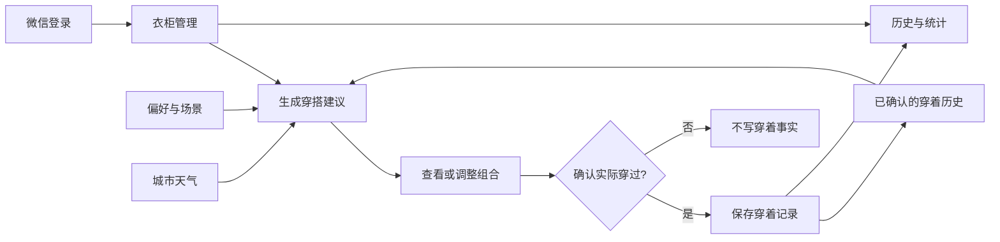
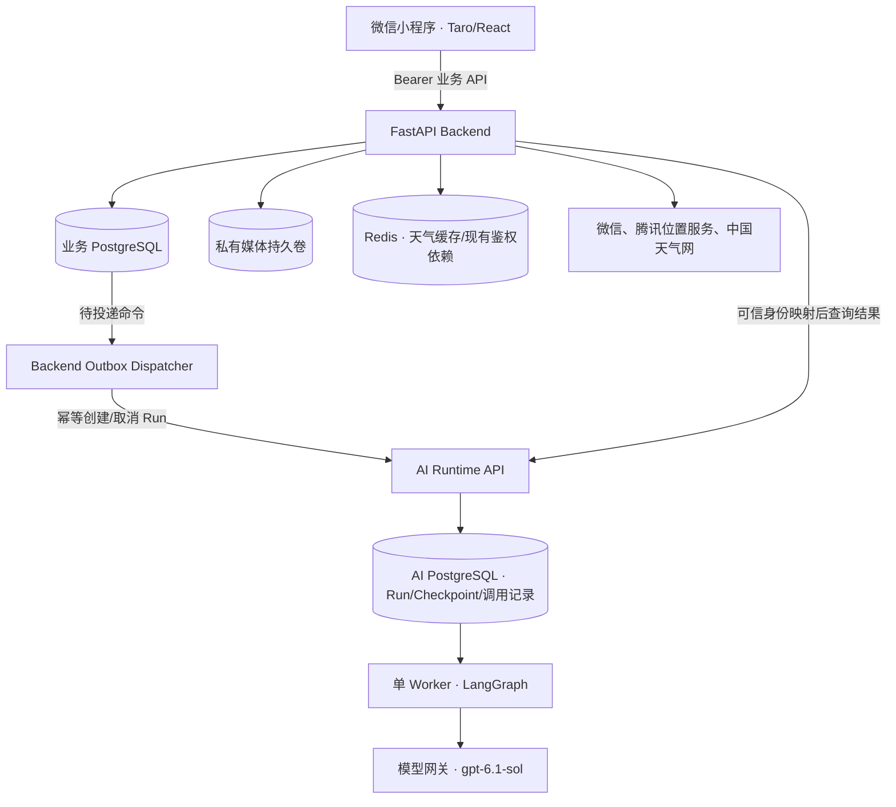

# 智能衣柜｜总体技术方案

> 依据：[当前 PRD](../../product/01-prd-draft.md)、[小程序设计交付](../../../miniprogram/design/wardrobe-ui-ux.md)、[业务 UI](../../../miniprogram/design/wardrobe-ui-spec.md) 与[可编辑稿](../../../miniprogram/design/wardrobe.pen)。本文描述拟建能力，不代表已实现或完成外部接入验证。

## 1. 目标与范围

实现一个个人微信小程序：**管理衣物 → 获取穿搭建议 → 确认实际穿着 → 查看历史与统计 → 为下一次推荐提供依据**。推荐基于本人可穿库存、可选偏好、城市天气和已记录穿着事实；即使属性、历史或天气不完整，也应给出有依据的结果或清晰说明限制。

当前范围包含微信登录、资料与设置、衣物管理、穿搭推荐、穿着记录和统计；不包含衣物 AI 识别、虚拟试衣、共享衣柜、独立 Web 业务页及模型个性化训练。

### 1.1 业务闭环

三条核心写入链路：

- **录入衣物**：小程序提交字段与可选的已上传照片 → Backend 校验并在业务库保存 → 刷新衣柜；失败保留输入。
- **生成建议**：Backend 过滤本人有效候选 → 持久化推荐请求 → AI Runtime 生成 → Backend 复核并发布 → 用户查看/调整；生成与调整均不写穿着事实。
- **确认穿着**：用户核对日期与衣物 → Backend 保存记录和当时的衣物快照 → 统计从已提交事实计算；修改或删除记录后同步反映。

## 2. 系统架构

| 模块 | 职责与边界 |
|---|---|
| 小程序 | 页面与草稿、拍照和主动定位、会话缓存、结果轮询；只调用 Backend，不自报资源归属 |
| Backend | 账号认证、所有业务事实的读写、媒体授权、天气获取、推荐候选和结果有效性检查 |
| 业务 PostgreSQL | User、衣物、偏好、穿着、推荐请求、版本和 Outbox；是业务权威数据源 |
| Dispatcher | 从业务 Outbox 可靠投递 AI Run 命令；不执行模型 |
| AI Runtime + Worker | 持久化冻结输入、执行模型、保存调用证据与结构化结果；不能直接读写业务库 |
| Redis / 文件卷 | Redis 缓存公共天气；私有持久卷保存图片，文件归属由业务 DB 校验 |

沿用 Backend 的 `route → service → repository → model`、AI 服务已有执行框架和两个独立数据库。**外部 HTTP、图片写盘和模型调用不放在业务数据库事务内；两库之间不进行跨库事务或 JOIN。**

## 3. 核心技术决策

| 领域 | 采用方案及理由 |
|---|---|
| 身份 | 微信 `code2Session` 关联现有 `users.id`，复用 JWT/撤销机制，兼容已有密码登录 |
| 媒体 | Backend 认证上传与私有本地持久卷；不引入 OSS，部署需保证卷持久化和备份 |
| 历史与统计 | 保存穿着时的名称/类别快照；统计直接聚合穿着事实，避免累计计数双写 |
| 推荐 | Backend 执行权限与硬约束检查；模型只组合候选并输出受控依据，结果发布时再次校验 |
| 异步执行 | 业务 Outbox → AI Run → 单 Worker；复用 LangGraph Checkpoint，不建第二套队列或多 Agent |
| 模型恢复 | 付费调用已发出但响应不明时标记 `unknown`，同次调用不自动重发；有持久响应则复用 |
| 天气 | 中国天气网 HTTP + 城市目录映射；按 `Asia/Shanghai` 的自然日缓存，同城市跨用户共享，7 天清理 |

### 3.1 必须保持的业务约束

1. 账号隔离：资源由服务端认证身份确定归属，任意 ID 均不能绕过 owner 校验。
2. 衣物创建和编辑后至少有**非空白名称或本人已就绪照片**；未填属性保持未知。
3. 只推荐本人当前可穿且不违反明确排除项的衣物；证据不足时说明限制，不虚构衣物或天气。
4. 生成、换整套、单品替换都不是实际穿着；只有用户确认保存才产生记录。
5. 编辑/归档衣物不覆盖既有穿着快照；记录修改和删除应正确更新统计口径。

## 4. 共享数据与接口约定

| 数据 | 权威位置 | 跨模块使用方式 |
|---|---|---|
| 账户、衣物、偏好、穿着记录、推荐请求 | 业务 PostgreSQL | 各资源按 `owner_id` 限定；跨功能按受控业务服务查询 |
| 图片实体 | 业务 DB 元数据 + 私有文件卷 | 上传成功且 `ready` 才允许绑定；图片下载先鉴权 |
| 库存、偏好、历史修订号 | 业务 PostgreSQL | 与对应修改同事务递增，供推荐结果有效性检查 |
| 天气事实 | 按地区共享的 Redis 日缓存 | Backend 生成本人有效的天气上下文，推荐冻结必要证据 |
| AI Run 与模型调用证据 | AI PostgreSQL | Backend 通过受信 Run API 和本人请求映射读取，不开放给小程序 |

- 对外沿用 `{code,message,data}`；401 表示未认证、404 隐藏他人资源、409 表示并发/幂等冲突、422 表示输入错误、429 表示限流，外部依赖失败返回受控错误，不透传供应商凭据或原文。Pydantic/OpenAPI 是真实接口契约来源，小程序类型由其生成，不维护第二套 DTO。
- 创建类操作使用稳定幂等键；同键不同 payload 返回冲突。涉及并发编辑的写入带 `expected_version`；错误不丢客户端草稿。
- 时间点用 UTC 保存；**穿着日期、统计自然日与天气缓存日界**统一按 `Asia/Shanghai` 计算。穿着日期保存为 `date`，不能从记录创建时间推断，也不随设备时区或选城改变；不提供用户时区字段或设置入口。
- 小程序按用户及会话代次隔离查询/草稿。退出、切号后取消本人在途查询并丢弃旧响应；页面离开只暂停推荐轮询，不等于取消任务。

## 5. 功能分方案

每份功能文档沿**用户动作 → 完整处理 → 数据/API → 关键异常**展开；简单能力合并描述，复杂部分才深入事务、状态与恢复。

| 功能（需求） | 详细设计 | 主要内容 |
|---|---|---|
| 微信登录与个人设置（[PRD §3.1](../../product/01-prd-draft.md#31-登录与个人设置)） | [账户与资料](features/account-and-profile.md) | 身份关联、会话、头像昵称与城市 |
| 衣物录入与衣柜管理（[PRD §3.2](../../product/01-prd-draft.md#32-衣物录入与管理)） | [衣柜管理](features/wardrobe.md) | 表单、媒体、属性、状态、筛选 |
| 偏好与穿搭推荐（[PRD §3.3](../../product/01-prd-draft.md#33-穿搭偏好)、[§3.4](../../product/01-prd-draft.md#34-ai-穿搭建议)） | [穿搭推荐](features/outfit-recommendation.md) | 候选、模型、持久化任务、结果消费 |
| 实际穿着与统计（[PRD §3.5](../../product/01-prd-draft.md#35-实际穿着记录)、[§3.6](../../product/01-prd-draft.md#36-衣柜与穿着统计)） | [穿着记录与统计](features/wear-history-and-stats.md) | 快照、日期、历史更正、聚合 |
| 推荐使用的外部天气（[PRD §3.4](../../product/01-prd-draft.md#34-ai-穿搭建议)） | [天气集成专项](integrations/weather.md) | 选城、定位、天气上下文、Redis 日缓存 |

## 6. 实施与验证边界

依赖关系为：**身份/权限 → 媒体和衣物 → 穿着事实与统计 → 天气上下文 → 推荐执行及全链路联通**。可并行处理没有共享契约冲突的页面或模块，不以文档数量机械拆分开发 Change。

**运行形态**：Backend API、Backend Outbox dispatcher、AI API 和持有数据库独占锁的单 Worker 分工运行；业务/AI PostgreSQL 分库存储，Redis 复用现有实例，媒体目录挂持久卷。后台投递与清理不能仅依赖请求进程内存任务。

**迁移**：业务表走 Alembic 前向迁移，AI Run/调用证据与 Checkpoint 依其已有迁移机制扩展；旧密码账号不因 `password_hash` 可空而失效。涉及有数据表或媒体卷时不以自动删表/删卷作为回滚。未完成的 Run 需保留对应 workflow/schema 执行器直至终结。

**排障**：用业务 `request_id`、Outbox 命令、`ai_run_id` 和模型 Operation ID 串联日志；记录受控错误、时间及可用的 usage，不记录微信 code、token、原始位置或个人图片。初期不预设未经测量的延迟/容量承诺。

验收重点：跨账号隔离；空衣物和重复保存；媒体文件/数据库部分失败；穿着日期、快照及统计修正；无天气/未知属性时的推荐；模型越权输出；推荐过期、取消、调用结果不明和 Worker 中断。各功能的检查细节见对应分方案；产品验收以 PRD 各节的用户行为、异常处理与数据保证为依据，规划定向关联对应章节。

**真实接入前需核验**：微信 AppID/Secret 及发布配置、模糊定位权限与地图 Key、天气内容的生产使用条件、模型结构化输出兼容性、媒体持久卷和备份。离线实现与测试可先完成，但不能把它们当作线上接入通过的证据。
